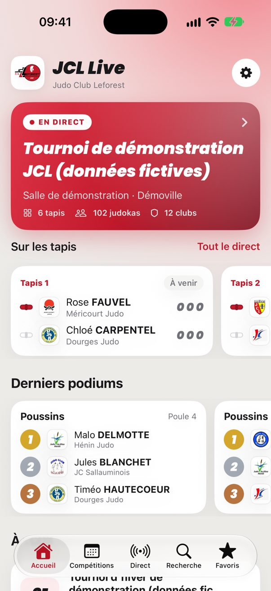
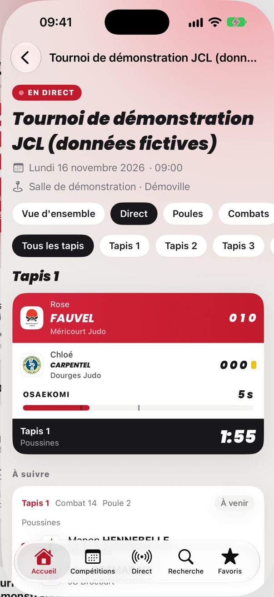
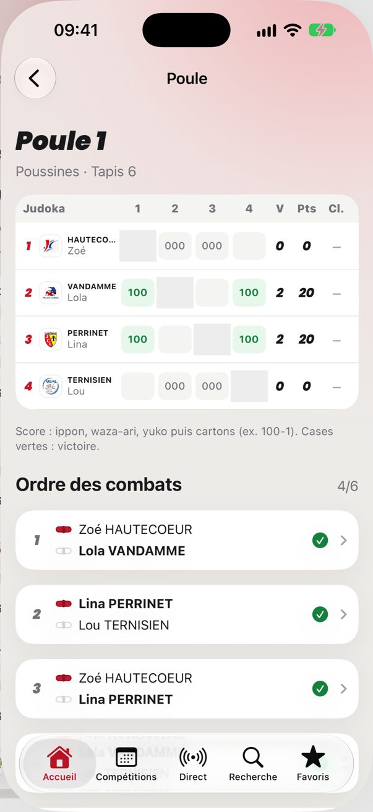
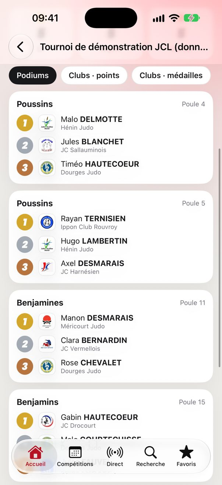
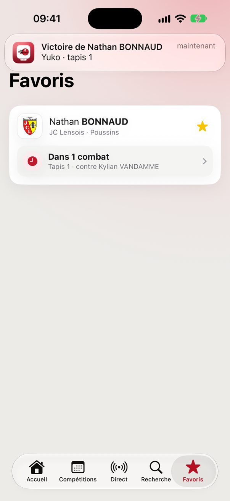
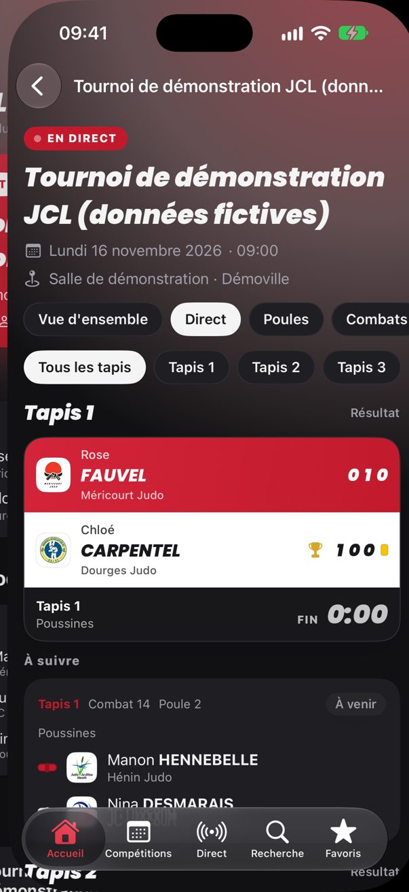

# JCL Live — application iPhone / iPad

Application native SwiftUI pour suivre en direct les compétitions JCL Compét : parents, coachs, public.
Structure inspirée des applications de diffusion du judo (accueil en direct, calendrier, tapis, tirage, ordre des combats,
judokas, résultats, favoris), avec le design du site : fond gris chaud, cartes blanches arrondies, rouge du club,
halo rosé, chiffres en Poppins italique, logos de club toujours dans une carte blanche.

| Accueil | Direct (osaekomi) | Feuille de poule | Résultats | Favoris + alerte | Mode sombre |
|---|---|---|---|---|---|
|  |  |  |  |  |  |

## Fonctions

- **Accueil** : compétition en direct (bandeau rouge), combats en cours sur chaque tapis, derniers podiums, compétitions à venir.
- **Compétitions** : en cours, à venir, terminées. Fiche compétition en onglets :
  vue d'ensemble, direct (tous les tapis ou un tapis), poules, combats (à venir / terminés / favoris, par tapis, recherche),
  judokas (recherche, filtre par club), résultats (podiums, classement des clubs aux points et aux médailles).
- **Combat** : tableau d'affichage façon TV (ligne rouge = premier appelé, ligne blanche = second), chrono qui tourne en
  direct sur l'horloge du serveur, golden score, matte, barre d'osaekomi avec les seuils yuko / waza-ari / ippon,
  cartons, déroulé horodaté, autres combats des deux judokas.
- **Feuille de poule** : grille des scores au format IWY-cartons, victoires, points, classement, ordre des combats.
- **Recherche** : judokas et clubs de toutes les compétitions en cours et à venir.
- **Favoris** : suivre un judoka (étoile), voir son prochain combat (« dans 2 combats, tapis 3 »), alertes locales
  quand il va combattre, quand il combat et quand son résultat est validé (au premier plan toutes les 20 s, et en
  arrière-plan quand iOS l'autorise).
- **Réglages** : adresse du site, alertes, thème clair / sombre / système.

Aucun compte, aucune donnée envoyée : l'application lit l'API publique en lecture seule `/api/v1/…`
(`app/Controllers/Api/MobileController.php`), qui ne publie ni date de naissance, ni licence, ni coordonnées.
Le direct respecte le réglage « direct public » de chaque compétition ; les poules n'apparaissent qu'une fois publiées ;
les photos seulement si l'option des photos de podium est activée.

## Ouvrir et lancer

Prérequis : Xcode 26 ou plus, iOS 17 minimum. Le site doit tourner (en local : `http://localhost:8095`).

```bash
open ios/JCLLive/JCLLive.xcodeproj
```

Choisir un simulateur ou l'iPhone branché, puis ▶︎. La signature est automatique avec l'équipe Apple Developer
`GQMVWRRBS6` (réglage `DEVELOPMENT_TEAM` du projet).

Ligne de commande (simulateur) :

```bash
xcodebuild -project ios/JCLLive/JCLLive.xcodeproj -scheme JCLLive -destination 'platform=iOS Simulator,name=iPhone 17' build
```

### Adresse du site

- Simulateur : `http://localhost:8095`.
- iPhone : valeur de `JCL_DEFAULT_SERVER` dans `Config/Base.xcconfig`, ou dans `Config/Local.xcconfig` (non versionné)
  pour pointer vers le Mac de développement, par exemple `JCL_DEFAULT_SERVER = http:/$()/NOM-DU-MAC.local:8095`.
- À tout moment : Réglages (roue dentée de l'accueil) › Site de la compétition.

Pour la version publiée, mettre l'adresse HTTPS du site dans `Config/Base.xcconfig`.

## Publier (TestFlight / App Store)

1. Mettre l'adresse HTTPS de production dans `Config/Base.xcconfig`.
2. Dans App Store Connect, créer l'app avec l'identifiant `fr.jcleforest.live`.
3. Xcode › Product › Archive, puis Distribute App › App Store Connect › Upload.
4. TestFlight pour les bénévoles et les familles, puis soumission à la validation.

Les alertes sont des notifications locales calculées sur le téléphone (pas de serveur de notifications push).
Pour des alertes garanties même application fermée, il faudra ajouter des notifications push (APNs) côté site.
